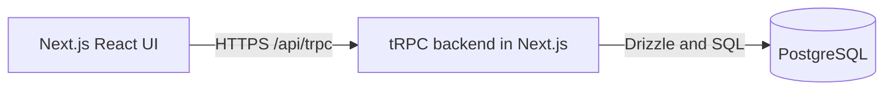

# Technical architecture

One Next.js application serves UI and tRPC on the same origin.

## Stack

| Area | Technology | Purpose |
| --- | --- | --- |
| Application | [Next.js App Router](https://nextjs.org/docs/app/getting-started/route-handlers), TypeScript, Node.js 24 LTS | Frontend and backend |
| API | [tRPC + TanStack Query](https://trpc.io/docs/client/tanstack-react-query/server-components), [Zod](https://zod.dev/) | Typed, validated queries and mutations; refresh after edits |
| Styling | [Tailwind CSS](https://tailwindcss.com/docs/installation/framework-guides/nextjs) | Layout and component styling |
| UI libraries | [Recharts](https://recharts.org/), [Lucide](https://lucide.dev/), [React DayPicker](https://daypicker.dev/) + [Radix Popover](https://www.radix-ui.com/primitives/docs/components/popover) | Report charts, 18px icons, date/month picker |
| Data | [PostgreSQL](https://www.postgresql.org/docs/current/datatype-numeric.html), [Drizzle](https://orm.drizzle.team/docs/migrations) | Constraints, transactions, SQL reports and migrations |
| Tests | [Vitest](https://vitest.dev/guide/), [Playwright](https://playwright.dev/docs/intro) | Unit, database/procedure and browser tests |
| Tooling | [tsx](https://tsx.is/), [Docker Compose](https://docs.docker.com/compose/), ESLint | Seed/migrate/verify scripts, local PostgreSQL, lint |

## Structure

- `src/app`: routing only — pages, layouts, `/api/trpc` and `/api/auth/[...all]` handlers.
- `src/features`: screen-level UI per feature; `src/components`: UI primitives and charts; `src/hooks`, `src/lib`: shared client hooks and pure helpers.
- `src/trpc`: client/server wiring; `src/contracts`: Zod schemas for every procedure input/output.
- `src/server`: env, db and auth; `api` (routers, middleware), `core` (errors, cursor, pagination) and the `lookups`, `employees`, `salaries`, `reports` modules. Procedures validate/authenticate; module operations own rules and transactions.
- `scripts`: migrate, seed, verify, benchmark; `tests`: unit, db and e2e.

Procedure inputs, outputs and errors: [tRPC contracts](trpc-contracts.md).

## Runtime rules

- Money: `NUMERIC(18,2)` in PostgreSQL; decimal strings in JSON. SQL handles salary calculations, filtering and stable pagination.
- Salary edits: lock employee, check expected revision, update current pay and `salary_revision`, and append history in one transaction.
- Authentication: Better Auth with Drizzle/PostgreSQL cookie sessions; see [login and security](login.md).

## Delivery

- One Next.js Node service + managed PostgreSQL over HTTPS; local PostgreSQL through Docker Compose.
- Commit migrations; run before release. Reproducibly seed 10,000 employees and salary history.
- Environment (`src/server/env.ts`, listed in `.env.example`): `DATABASE_URL` (app role), `DATABASE_OWNER_URL` (migrations/seed only), `APP_URL` (auth base URL and mutation origin), `BETTER_AUTH_SECRET` and `CURSOR_SECRET` (≥ 32 characters, distinct), `DEMO_HR_EMAIL`, `DEMO_HR_PASSWORD`.
- CI: typecheck, lint, build, unit/procedure tests against disposable PostgreSQL and key browser workflows.
