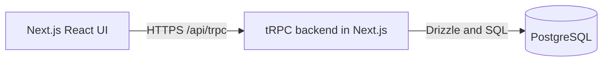

# Technical architecture

One Next.js application serves UI and tRPC on the same origin.

## Stack

| Area | Technology | Purpose |
| --- | --- | --- |
| Application | [Next.js App Router](https://nextjs.org/docs/app/getting-started/route-handlers), TypeScript, Node.js 24 LTS | Frontend and backend |
| API | [tRPC + TanStack Query](https://trpc.io/docs/client/tanstack-react-query/server-components), [Zod](https://zod.dev/) | Typed, validated queries and mutations; refresh after edits |
| Styling | [Tailwind CSS](https://tailwindcss.com/docs/installation/framework-guides/nextjs) | Layout and component styling |
| Data | [PostgreSQL](https://www.postgresql.org/docs/current/datatype-numeric.html), [Drizzle](https://orm.drizzle.team/docs/migrations) | Constraints, transactions, SQL reports and migrations |
| Tests | [Vitest](https://vitest.dev/guide/), [Playwright](https://playwright.dev/docs/intro) | Unit, database/procedure and browser tests |

## Structure

- `src/app`: pages, layouts, `/api/trpc` and `/api/auth/[...all]` handlers.
- `src/server`: auth, employees, salaries, reports and database modules. Procedures validate/authenticate; feature functions own operations and transactions.

## Runtime rules

- Money: `NUMERIC(18,2)` in PostgreSQL; decimal strings in JSON. SQL handles salary calculations, filtering and stable pagination.
- Salary edits: lock employee, check expected revision, update current pay and append history in one transaction.
- Authentication: Better Auth with Drizzle/PostgreSQL cookie sessions; see [login and security](login.md).

## Delivery

- One Next.js Node service + managed PostgreSQL over HTTPS; local PostgreSQL through Docker Compose.
- Commit migrations; run before release. Configure credentials through environment variables; reproducibly seed 10,000 employees and salary history.
- CI: typecheck, build, unit/procedure tests against disposable PostgreSQL and key browser workflows.
