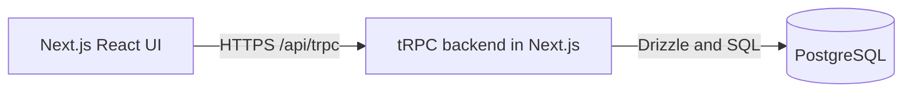

# Technical architecture

One Next.js application serves UI and tRPC on the same origin.

## Stack

| Area | Technology | Purpose |
| --- | --- | --- |
| Application | [Next.js App Router](https://nextjs.org/docs/app/getting-started/route-handlers), TypeScript, Node.js 24 LTS | Frontend and backend |
| API | [tRPC + TanStack Query](https://trpc.io/docs/client/tanstack-react-query/server-components), [Zod](https://zod.dev/) | Typed, validated queries and mutations; refresh after edits |
| Styling | [Tailwind CSS](https://tailwindcss.com/docs/installation/framework-guides/nextjs) | Layout and component styling |
| UI libraries | [Recharts](https://recharts.org/), [Lucide](https://lucide.dev/), [React DayPicker](https://daypicker.dev/) + [Radix Popover](https://www.radix-ui.com/primitives/docs/components/popover) | Report charts, 18px icons, the date and month pickers |
| Data | [PostgreSQL](https://www.postgresql.org/docs/current/datatype-numeric.html), [Drizzle](https://orm.drizzle.team/docs/migrations) | Constraints, transactions, SQL reports and migrations |
| Tests | [Vitest](https://vitest.dev/guide/), [Playwright](https://playwright.dev/docs/intro) | Unit, database/procedure and browser tests |
| Tooling | [tsx](https://tsx.is/), [Docker Compose](https://docs.docker.com/compose/), ESLint | Seed/migrate/verify scripts, local PostgreSQL, lint |

## Structure

- `src/app`: routing only — pages, layouts, `/api/trpc` and `/api/auth/[...all]` handlers.
- `src/features`: screen-level UI per feature; `src/components`: UI primitives and charts; `src/hooks`, `src/lib`: shared client hooks and pure helpers.
- `src/trpc`: client/server wiring; `src/contracts`: Zod schemas for every procedure input/output.
- `src/server`: env, db and auth; `api` (routers, middleware), `core` (errors, cursor, pagination) and the `lookups`, `employees`, `salaries`, `reports` modules. Procedures validate/authenticate; module operations own rules and transactions.
- `scripts`: migrate, seed, verify, benchmark; `tests`: unit, db and e2e.

Procedure inputs, outputs and errors: [tRPC contracts](trpc-contracts.md).

## Runtime rules

- Money: `NUMERIC(18,2)` in PostgreSQL; decimal strings in JSON. SQL handles salary calculations, filtering and stable pagination.
- Salary edits: lock employee, check expected revision, update current pay and `salary_revision`, and append history in one transaction.
- Authentication: Better Auth with Drizzle/PostgreSQL cookie sessions; see [login and security](login.md).

## Delivery

- One Next.js Node service + managed PostgreSQL over HTTPS; local PostgreSQL through Docker Compose.
- Commit migrations, each granting the app role on the tables it creates; run before release. Reproducibly seed 10,000 employees and salary history.
- Environment (`src/server/env.ts`, listed in `.env.example`; parsed lazily, owner URL separately so tooling needs only it): `DATABASE_URL` (app role), `DATABASE_OWNER_URL` (migrations/seed only), `APP_URL` (auth base URL; its origin is the only accepted mutation `Origin`), `BETTER_AUTH_SECRET` and `CURSOR_SECRET` (≥ 32 characters, distinct), `DEMO_HR_EMAIL`, `DEMO_HR_PASSWORD`.
- CI: typecheck, lint, build, unit/procedure tests against disposable PostgreSQL, seed + `db:verify`, and key browser workflows.

## Report performance

`npm run bench` (`scripts/bench-reports.ts`) times each report request as the app role on the 10,000-employee seed (41,826 history entries): first page and count together, then the summary, with the benchmark's snapshot build in the same transaction. 3 warmups, 20 runs, local PostgreSQL 17 (Docker):

| Request | p50 ms | p95 ms |
| --- | ---: | ---: |
| Salary commitment, no filters / IN + engineering | 8.7 / 3.0 | 8.9 / 3.6 |
| Department breakdown, no filters / EUR | 17.0 / 6.3 | 17.9 / 6.6 |
| Salary growth, 12 / 24 / 180 months | 33 / 47 / 91 | 37 / 51 / 96 |
| Salary growth, 24 months, IN + engineering | 25.0 | 25.4 |
| Historical benchmark, 24 months (default range) / + finance | 331 / 310 | 332 / 321 |
| Historical benchmark, 24 months, IN + USD | 70 | 71 |
| Historical benchmark, 180 months | 582 | 589 |

- The benchmark builds its month-end snapshot once per request into a transaction-scoped temporary table (36 snapshot months × ~7,400 active employees ≈ 266,000 rows for the default range): per-entry integer month ranges, one hash aggregation over both grouping sets, and exact percentiles from per-group sorted cents. `EXPLAIN (ANALYZE, BUFFERS)` (`npm run bench -- --explain`): ~130 ms expanding entries into snapshot rows, ~120 ms aggregating and sorting, all from shared buffers. JIT is off and `work_mem` is 256MB for that transaction only: JIT compilation alone cost ~700 ms, and the default `work_mem` spilled the aggregation to disk.
- The default benchmark range sits just above the ~300 ms goal and 15 years take ~0.6 s; every other report is under 100 ms. No plan showed a missing index (the benchmark needs every history entry for its validity windows), so no index was added. A month-end snapshot table maintained by salary and details writes is the next step if the benchmark must get faster.

### Production (Vercel iad1 + Neon free tier)

Same 10,000-employee seed on PostgreSQL 18.6, app and database both in us-east (~1–2 ms apart):

- The benchmark's snapshot build takes ~700 ms of server-side execution on Neon (`EXPLAIN ANALYZE`, 24 months) against ~250 ms on local PostgreSQL 17: the free tier's compute is small.
- Expected per request: commitment, department and growth well under 100 ms of database time; the benchmark ~0.8–0.9 s; the first request after Neon scales to zero adds ~1 s of cold start. Timings from a remote machine are dominated by ~310 ms round trips and are not representative.
- Requirements: the app role needs the `TEMP` privilege (Neon's default); `work_mem` 256MB is a per-transaction ceiling for benchmark requests only (~12 MB used).
- Accepted for this scope. If the benchmark must get faster: larger compute, or the month-end snapshot table above.
